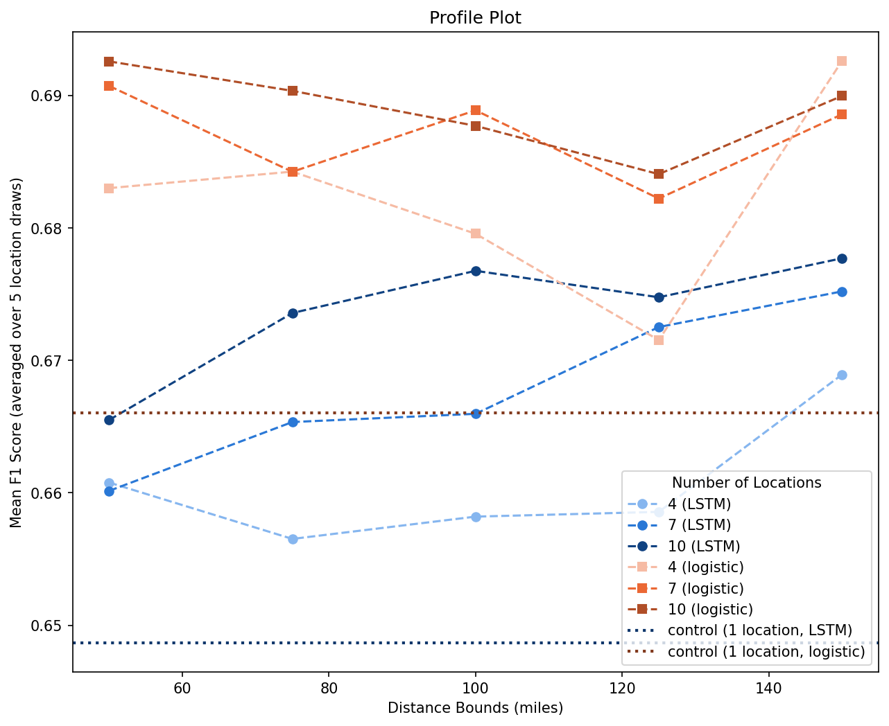

# Precipitation LSTM Analysis Report

## Per-Cell Summary

| group   |   n |   mean |     sd |
|:--------|----:|-------:|-------:|
| control |   3 | 0.6487 | 0.0019 |
| 4,50    |   5 | 0.6608 | 0.0057 |
| 4,75    |   5 | 0.6565 | 0.0055 |
| 4,100   |   5 | 0.6582 | 0.0099 |
| 4,125   |   5 | 0.6586 | 0.0044 |
| 4,150   |   5 | 0.6689 | 0.0058 |
| 7,50    |   5 | 0.6602 | 0.0031 |
| 7,75    |   5 | 0.6653 | 0.0064 |
| 7,100   |   5 | 0.666  | 0.0069 |
| 7,125   |   5 | 0.6725 | 0.0086 |
| 7,150   |   5 | 0.6752 | 0.0093 |
| 10,50   |   5 | 0.6655 | 0.0032 |
| 10,75   |   5 | 0.6736 | 0.0041 |
| 10,100  |   5 | 0.6768 | 0.0035 |
| 10,125  |   5 | 0.6748 | 0.0069 |
| 10,150  |   5 | 0.6777 | 0.0049 |

## LSTM: Parametric Two-Way ANOVA (treatment cells only, draw-averaged F1)

**Assumption checks (treatment cells only):**
- Levene's test (homoscedasticity across 15 cells): stat=0.7706, p=0.6955
- Shapiro-Wilk (normality of ANOVA residuals): stat=0.9863, p=0.5987

| Term                     |   sum_sq |   df |        F |   PR(>F) |
|:-------------------------|---------:|-----:|---------:|---------:|
| C(num_locations)         |   0.0021 |    2 |  27.4261 |   0      |
| C(dist)                  |   0.0012 |    4 |   7.4158 |   0.0001 |
| C(num_locations):C(dist) |   0.0005 |    8 |   1.6487 |   0.1302 |
| Residual                 |   0.0023 |   60 | nan      | nan      |

## Assumption Checks (control & 15 treatment cells)

- Levene's test (homoscedasticity across 16 groups): stat=0.8404, p=0.6305
- Shapiro-Wilk (normality of one-way ANOVA residuals): stat=0.9885, p=0.7132

## Control vs. Each Cell (Dunnett's Test)

| group   |   p-value |
|:--------|----------:|
| 10,150  |    0      |
| 10,100  |    0      |
| 7,150   |    0      |
| 10,125  |    0      |
| 10,75   |    0      |
| 7,125   |    0      |
| 4,150   |    0.0003 |
| 7,100   |    0.0031 |
| 10,50   |    0.0042 |
| 7,75    |    0.0046 |
| 4,50    |    0.071  |
| 7,50    |    0.0972 |
| 4,125   |    0.201  |
| 4,100   |    0.2333 |
| 4,75    |    0.4358 |

## Treatment-vs-Treatment Pairwise Comparisons (Tukey's HSD)

| comparison       |   p-value |
|:-----------------|----------:|
| 10,150 vs 4,75   |    0.0001 |
| 10,100 vs 4,75   |    0.0003 |
| 10,150 vs 4,100  |    0.0006 |
| 10,150 vs 4,125  |    0.0008 |
| 4,75 vs 7,150    |    0.0012 |
| 10,100 vs 4,100  |    0.0014 |
| 10,125 vs 4,75   |    0.0018 |
| 10,100 vs 4,125  |    0.0019 |
| 10,150 vs 7,50   |    0.0032 |
| 10,75 vs 4,75    |    0.0049 |
| 4,100 vs 7,150   |    0.0051 |
| 10,150 vs 4,50   |    0.0054 |
| 4,125 vs 7,150   |    0.0068 |
| 10,100 vs 7,50   |    0.007  |
| 10,125 vs 4,100  |    0.0073 |
| 10,125 vs 4,125  |    0.0097 |
| 4,75 vs 7,125    |    0.0114 |
| 10,100 vs 4,50   |    0.0115 |
| 10,75 vs 4,100   |    0.0184 |
| 7,150 vs 7,50    |    0.0232 |
| 10,75 vs 4,125   |    0.024  |
| 10,125 vs 7,50   |    0.032  |
| 4,50 vs 7,150    |    0.0365 |
| 4,100 vs 7,125   |    0.0396 |
| 10,125 vs 4,50   |    0.0496 |
| 4,125 vs 7,125   |    0.0508 |
| 10,75 vs 7,50    |    0.072  |
| 10,75 vs 4,50    |    0.1068 |
| 4,150 vs 4,75    |    0.135  |
| 7,125 vs 7,50    |    0.138  |
| 10,150 vs 7,75   |    0.1383 |
| 10,150 vs 10,50  |    0.1515 |
| 10,150 vs 7,100  |    0.1953 |
| 4,50 vs 7,125    |    0.1956 |
| 10,100 vs 7,75   |    0.2313 |
| 10,100 vs 10,50  |    0.2505 |
| 10,100 vs 7,100  |    0.3118 |
| 4,100 vs 4,150   |    0.3225 |
| 4,125 vs 4,150   |    0.3768 |
| 7,150 vs 7,75    |    0.4591 |
| 10,50 vs 7,150   |    0.4865 |
| 4,75 vs 7,100    |    0.5317 |
| 10,125 vs 7,75   |    0.5362 |
| 10,125 vs 10,50  |    0.5644 |
| 7,100 vs 7,150   |    0.5675 |
| 10,50 vs 4,75    |    0.6132 |
| 4,75 vs 7,75     |    0.6411 |
| 10,125 vs 7,100  |    0.6455 |
| 10,150 vs 4,150  |    0.6484 |
| 4,150 vs 7,50    |    0.6494 |
| 10,75 vs 7,75    |    0.7405 |
| 4,150 vs 4,50    |    0.7533 |
| 10,50 vs 10,75   |    0.7653 |
| 10,100 vs 4,150  |    0.8    |
| 4,100 vs 7,100   |    0.8105 |
| 10,75 vs 7,100   |    0.8308 |
| 4,125 vs 7,100   |    0.8567 |
| 10,50 vs 4,100   |    0.8686 |
| 7,125 vs 7,75    |    0.8827 |
| 4,100 vs 7,75    |    0.886  |
| 10,50 vs 7,125   |    0.8989 |
| 10,50 vs 4,125   |    0.9056 |
| 4,125 vs 7,75    |    0.9197 |
| 7,100 vs 7,125   |    0.9374 |
| 4,150 vs 7,150   |    0.9545 |
| 10,125 vs 4,150  |    0.9749 |
| 7,100 vs 7,50    |    0.9757 |
| 10,50 vs 7,50    |    0.9883 |
| 7,50 vs 7,75     |    0.9911 |
| 10,150 vs 7,125  |    0.9912 |
| 4,50 vs 7,100    |    0.9912 |
| 10,50 vs 4,50    |    0.9965 |
| 10,75 vs 4,150   |    0.997  |
| 4,50 vs 7,75     |    0.9975 |
| 4,50 vs 4,75     |    0.9988 |
| 10,100 vs 7,125  |    0.9988 |
| 10,150 vs 10,75  |    0.9991 |
| 4,75 vs 7,50     |    0.9998 |
| 4,150 vs 7,125   |    0.9998 |
| 4,150 vs 7,75    |    0.9998 |
| 10,50 vs 4,150   |    0.9999 |
| 10,100 vs 10,75  |    1      |
| 4,150 vs 7,100   |    1      |
| 10,125 vs 10,150 |    1      |
| 7,125 vs 7,150   |    1      |
| 4,100 vs 4,50    |    1      |
| 10,150 vs 7,150  |    1      |
| 10,125 vs 7,125  |    1      |
| 4,125 vs 4,50    |    1      |
| 4,125 vs 4,75    |    1      |
| 10,100 vs 10,125 |    1      |
| 4,100 vs 7,50    |    1      |
| 4,100 vs 4,75    |    1      |
| 10,75 vs 7,150   |    1      |
| 4,125 vs 7,50    |    1      |
| 10,100 vs 7,150  |    1      |
| 10,125 vs 10,75  |    1      |
| 10,75 vs 7,125   |    1      |
| 10,100 vs 10,150 |    1      |
| 4,50 vs 7,50     |    1      |
| 7,100 vs 7,75    |    1      |
| 10,50 vs 7,100   |    1      |
| 10,125 vs 7,150  |    1      |
| 10,50 vs 7,75    |    1      |
| 4,100 vs 4,125   |    1      |

## Per-Cell Summary (Baseline)

| group   |   n |   mean |       sd |
|:--------|----:|-------:|---------:|
| control |   1 | 0.666  | nan      |
| 4,50    |   5 | 0.683  |   0.0075 |
| 4,75    |   5 | 0.6843 |   0.0063 |
| 4,100   |   5 | 0.6796 |   0.0156 |
| 4,125   |   5 | 0.6715 |   0.0071 |
| 4,150   |   5 | 0.6926 |   0.0166 |
| 7,50    |   5 | 0.6907 |   0.004  |
| 7,75    |   5 | 0.6843 |   0.0093 |
| 7,100   |   5 | 0.6889 |   0.0067 |
| 7,125   |   5 | 0.6822 |   0.0118 |
| 7,150   |   5 | 0.6886 |   0.0075 |
| 10,50   |   5 | 0.6926 |   0.0021 |
| 10,75   |   5 | 0.6904 |   0.0096 |
| 10,100  |   5 | 0.6877 |   0.0128 |
| 10,125  |   5 | 0.6841 |   0.0042 |
| 10,150  |   5 | 0.69   |   0.0069 |

## Baseline (Logistic Regression) Comparison

Baseline control F1 (deterministic, single value): **0.6660**

|   num_locations |   dist |   logistic |   LSTM | LSTM beats logistic   |
|----------------:|-------:|-----------:|-------:|:----------------------|
|               4 |     50 |     0.683  | 0.6608 | False                 |
|               4 |     75 |     0.6843 | 0.6565 | False                 |
|               4 |    100 |     0.6796 | 0.6582 | False                 |
|               4 |    125 |     0.6715 | 0.6586 | False                 |
|               4 |    150 |     0.6926 | 0.6689 | False                 |
|               7 |     50 |     0.6907 | 0.6602 | False                 |
|               7 |     75 |     0.6843 | 0.6653 | False                 |
|               7 |    100 |     0.6889 | 0.666  | False                 |
|               7 |    125 |     0.6822 | 0.6725 | False                 |
|               7 |    150 |     0.6886 | 0.6752 | False                 |
|              10 |     50 |     0.6926 | 0.6655 | False                 |
|              10 |     75 |     0.6904 | 0.6736 | False                 |
|              10 |    100 |     0.6877 | 0.6768 | False                 |
|              10 |    125 |     0.6841 | 0.6748 | False                 |
|              10 |    150 |     0.69   | 0.6777 | False                 |

## Baseline: Parametric Two-Way ANOVA (treatment cells only)

- Levene's test (homoscedasticity across 15 cells): stat=1.1747, p=0.3177
- Shapiro-Wilk (normality of ANOVA residuals): stat=0.9819, p=0.3615

| Term                     |   sum_sq |   df |        F |   PR(>F) |
|:-------------------------|---------:|-----:|---------:|---------:|
| C(num_locations)         |   0.0006 |    2 |   3.3661 |   0.0412 |
| C(dist)                  |   0.0011 |    4 |   3.0591 |   0.0232 |
| C(num_locations):C(dist) |   0.0005 |    8 |   0.7581 |   0.6405 |
| Residual                 |   0.0053 |   60 | nan      | nan      |

## Treatment-vs-Treatment Pairwise Comparisons (Baseline, Tukey's HSD)

| comparison       |   p-value |
|:-----------------|----------:|
| 4,125 vs 4,150   |    0.0507 |
| 10,50 vs 4,125   |    0.0513 |
| 4,125 vs 7,50    |    0.1127 |
| 10,75 vs 4,125   |    0.1304 |
| 10,150 vs 4,125  |    0.151  |
| 4,125 vs 7,100   |    0.2227 |
| 4,125 vs 7,150   |    0.2468 |
| 10,100 vs 4,125  |    0.3236 |
| 4,100 vs 4,150   |    0.6731 |
| 10,50 vs 4,100   |    0.6762 |
| 4,125 vs 4,75    |    0.7089 |
| 4,125 vs 7,75    |    0.7101 |
| 10,125 vs 4,125  |    0.7297 |
| 4,125 vs 4,50    |    0.8322 |
| 4,100 vs 7,50    |    0.8579 |
| 10,75 vs 4,100   |    0.8853 |
| 4,125 vs 7,125   |    0.8925 |
| 10,150 vs 4,100  |    0.9101 |
| 4,150 vs 7,125   |    0.9113 |
| 10,50 vs 7,125   |    0.9129 |
| 4,150 vs 4,50    |    0.9501 |
| 10,50 vs 4,50    |    0.9512 |
| 4,100 vs 7,100   |    0.9603 |
| 4,100 vs 7,150   |    0.9697 |
| 10,125 vs 4,150  |    0.9808 |
| 10,125 vs 10,50  |    0.9813 |
| 7,125 vs 7,50    |    0.9815 |
| 4,150 vs 7,75    |    0.9841 |
| 4,150 vs 4,75    |    0.9843 |
| 10,50 vs 7,75    |    0.9846 |
| 10,50 vs 4,75    |    0.9847 |
| 10,100 vs 4,100  |    0.9874 |
| 10,75 vs 7,125   |    0.9876 |
| 4,100 vs 4,125   |    0.989  |
| 10,150 vs 7,125  |    0.9921 |
| 4,50 vs 7,50     |    0.9924 |
| 10,75 vs 4,50    |    0.9953 |
| 10,150 vs 4,50   |    0.9972 |
| 7,100 vs 7,125   |    0.9982 |
| 10,125 vs 7,50   |    0.9983 |
| 7,50 vs 7,75     |    0.9987 |
| 4,75 vs 7,50     |    0.9987 |
| 7,125 vs 7,150   |    0.9989 |
| 10,125 vs 10,75  |    0.9991 |
| 10,75 vs 7,75    |    0.9993 |
| 10,75 vs 4,75    |    0.9993 |
| 10,125 vs 10,150 |    0.9995 |
| 4,50 vs 7,100    |    0.9996 |
| 10,150 vs 7,75   |    0.9997 |
| 10,150 vs 4,75   |    0.9997 |
| 4,50 vs 7,150    |    0.9998 |
| 10,100 vs 7,125  |    0.9998 |
| 10,100 vs 4,150  |    0.9999 |
| 10,100 vs 10,50  |    0.9999 |
| 10,125 vs 7,100  |    1      |
| 10,100 vs 4,50   |    1      |
| 4,100 vs 4,75    |    1      |
| 4,100 vs 7,75    |    1      |
| 7,100 vs 7,75    |    1      |
| 4,75 vs 7,100    |    1      |
| 10,125 vs 7,150  |    1      |
| 10,125 vs 4,100  |    1      |
| 7,150 vs 7,75    |    1      |
| 4,75 vs 7,150    |    1      |
| 4,150 vs 7,150   |    1      |
| 10,50 vs 7,150   |    1      |
| 4,150 vs 7,100   |    1      |
| 10,50 vs 7,100   |    1      |
| 10,100 vs 10,125 |    1      |
| 10,100 vs 7,75   |    1      |
| 10,100 vs 4,75   |    1      |
| 4,100 vs 4,50    |    1      |
| 10,100 vs 7,50   |    1      |
| 4,100 vs 7,125   |    1      |
| 10,100 vs 10,75  |    1      |
| 10,150 vs 4,150  |    1      |
| 10,150 vs 10,50  |    1      |
| 10,100 vs 10,150 |    1      |
| 10,75 vs 4,150   |    1      |
| 10,50 vs 10,75   |    1      |
| 7,150 vs 7,50    |    1      |
| 4,75 vs 7,125    |    1      |
| 7,125 vs 7,75    |    1      |
| 4,150 vs 7,50    |    1      |
| 10,50 vs 7,50    |    1      |
| 10,125 vs 7,125  |    1      |
| 7,100 vs 7,50    |    1      |
| 10,75 vs 7,150   |    1      |
| 10,75 vs 7,100   |    1      |
| 10,150 vs 7,150  |    1      |
| 4,50 vs 4,75     |    1      |
| 4,50 vs 7,75     |    1      |
| 10,100 vs 7,100  |    1      |
| 10,150 vs 7,100  |    1      |
| 10,125 vs 4,50   |    1      |
| 10,100 vs 7,150  |    1      |
| 4,50 vs 7,125    |    1      |
| 10,150 vs 7,50   |    1      |
| 10,50 vs 4,150   |    1      |
| 4,75 vs 7,75     |    1      |
| 7,100 vs 7,150   |    1      |
| 10,125 vs 4,75   |    1      |
| 10,125 vs 7,75   |    1      |
| 10,75 vs 7,50    |    1      |
| 10,150 vs 10,75  |    1      |

## Combined LSTM-vs-Baseline Two-Way ANOVA

- Levene's test (homoscedasticity across model x cell groups): stat=1.1544, p=0.2893
- Shapiro-Wilk (normality of ANOVA residuals): stat=0.9913, p=0.4917

| Term                      |   sum_sq |   df |        F |   PR(>F) |
|:--------------------------|---------:|-----:|---------:|---------:|
| C(model)                  |   0.0131 |    1 | 205.728  |   0      |
| C(num_locations)          |   0.0025 |    2 |  19.6171 |   0      |
| C(dist)                   |   0.0012 |    4 |   4.7611 |   0.0013 |
| C(model):C(num_locations) |   0.0003 |    2 |   2      |   0.1395 |
| C(model):C(dist)          |   0.001  |    4 |   4.0999 |   0.0037 |
| C(num_locations):C(dist)  |   0.0006 |    8 |   1.2252 |   0.2895 |
| Residual                  |   0.0081 |  128 | nan      | nan      |

## Profile Plot

